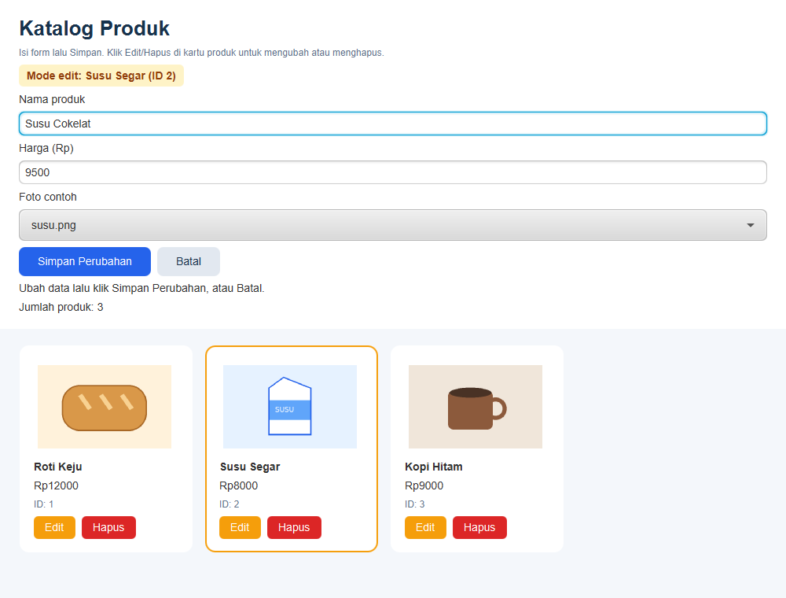
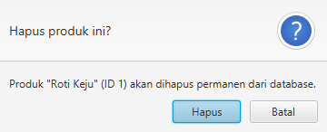

# Katalog Produk (UPI Store)

Aplikasi desktop **JavaFX** untuk mengelola katalog produk sederhana. Setiap produk punya nama,
harga, dan foto, lalu ditampilkan sebagai kartu di katalog. Semua data disimpan di database
**SQLite**, jadi data tetap ada walaupun aplikasi ditutup.

Aplikasi ini mendukung CRUD lengkap:

| Fitur | Keterangan |
|---|---|
| **Tambah** | Isi form lalu klik **Simpan** → produk baru masuk ke database |
| **Lihat** | Semua produk tampil sebagai kartu, beserta jumlah produk |
| **Edit** | Klik **Edit** di kartu → data masuk ke form → ubah → klik **Simpan Perubahan** |
| **Batal** | Klik **Batal** (atau tekan `Esc`) untuk membatalkan edit / mengosongkan form tanpa menyimpan |
| **Hapus** | Klik **Hapus** di kartu → muncul konfirmasi → **Hapus** untuk menghapus, **Batal** untuk membatalkan |





## Teknologi

- Java 17+ (sudah diuji dengan JDK 21)
- JavaFX 21 (`javafx-controls`, `javafx-fxml`)
- SQLite lewat `sqlite-jdbc` 3.49.1.0
- Maven

## Persyaratan

- **JDK 17 atau lebih baru**
- **Maven**, atau IDE yang sudah membawa Maven (misalnya **Apache NetBeans**, IntelliJ IDEA)
- Tidak perlu memasang SQLite secara terpisah. Driver-nya sudah ikut lewat Maven, dan file
  database dibuat otomatis.

## Cara Menjalankan

### Opsi 1: NetBeans

1. `File` → `Open Project...` → pilih folder `KatalogProduk`.
2. Klik kanan project → **Run** (atau tekan `F6`).

### Opsi 2: Terminal (Maven)

Dari dalam folder `KatalogProduk`:

```bash
mvn clean javafx:run
```

Saat aplikasi jalan, terminal/Output menampilkan lokasi database yang dipakai, contoh:

```
DATABASE AKTIF: C:\...\KatalogProduk\data\katalog.db
```

## Cara Pakai

### Menambah produk
1. Isi **Nama produk**, misalnya `Roti Cokelat`.
2. Isi **Harga (Rp)** dengan angka bulat tanpa titik, misalnya `10000`.
3. Pilih **Foto contoh** (`roti.png`, `susu.png`, atau `kopi.png`).
4. Klik **Simpan** (atau tekan `Enter`). Produk langsung muncul di katalog.

### Mengedit produk
1. Klik tombol **Edit** (oranye) pada kartu produk.
2. Form terisi data produk itu, muncul label **Mode edit**, dan kartunya diberi garis oranye.
3. Ubah nama, harga, atau foto.
4. Klik **Simpan Perubahan**. Data di database diperbarui dan form kembali ke mode tambah.

### Membatalkan
- Saat mode edit, klik **Batal** (atau tekan `Esc`). Perubahan di form dibuang dan data di
  database **tidak berubah**.
- Di luar mode edit, **Batal** mengosongkan form.

### Menghapus produk
1. Klik tombol **Hapus** (merah) pada kartu produk.
2. Muncul dialog konfirmasi:
   - **Hapus** → produk dihapus permanen dari database.
   - **Batal** → tidak ada yang dihapus.

### Validasi
- Nama wajib diisi.
- Harga harus angka bulat dan lebih dari 0.
- Foto wajib dipilih.

Kalau ada yang salah, pesan kesalahan muncul di bawah tombol dan data tidak disimpan.

## Database SQLite

- Lokasi file: `data/katalog.db` di dalam folder kerja tempat aplikasi dijalankan (biasanya
  folder project).
- File dan tabel dibuat otomatis saat aplikasi pertama kali dijalankan.
- Struktur tabel:

```sql
CREATE TABLE IF NOT EXISTS produk (
    id    INTEGER PRIMARY KEY,
    nama  TEXT    NOT NULL CHECK(length(trim(nama)) > 0),
    harga INTEGER NOT NULL CHECK(harga > 0),
    foto  TEXT    NOT NULL CHECK(length(trim(foto)) > 0)
);
```

- Query yang dipakai aplikasi (lihat `ProdukRepository.java`):

| Operasi | SQL |
|---|---|
| Tambah | `INSERT INTO produk (nama, harga, foto) VALUES (?, ?, ?)` |
| Lihat | `SELECT id, nama, harga, foto FROM produk ORDER BY id` |
| Edit | `UPDATE produk SET nama = ?, harga = ?, foto = ? WHERE id = ?` |
| Hapus | `DELETE FROM produk WHERE id = ?` |

- Untuk melihat isi database di luar aplikasi, buka `data/katalog.db` dengan
  [DB Browser for SQLite](https://sqlitebrowser.org/).
- Untuk mengosongkan semua data, tutup aplikasi lalu hapus file `data/katalog.db`. File baru
  yang kosong dibuat lagi saat aplikasi dijalankan.
- File database tidak ikut di-upload ke Git (lihat `.gitignore`), jadi setiap komputer punya
  data sendiri.

## Struktur Project

```
KatalogProduk/
├── pom.xml                              # Konfigurasi Maven & dependency
├── data/                                # Tempat file katalog.db (dibuat otomatis)
├── docs/                                # Screenshot untuk README
└── src/main/
    ├── java/
    │   ├── main/MainApp.java            # Titik masuk aplikasi JavaFX
    │   ├── controller/KatalogController.java  # Logika tombol Simpan/Edit/Batal/Hapus
    │   ├── data/ProdukRepository.java   # Query SQLite (CRUD)
    │   ├── db/Database.java             # Koneksi & pembuatan tabel SQLite
    │   └── model/Produk.java            # Model data + validasi
    └── resources/
        ├── image/                       # Foto produk (roti, susu, kopi)
        └── view/
            ├── katalog.fxml             # Tampilan (form + katalog)
            └── styles/app.css           # Gaya tampilan
```

## Menambah Pilihan Foto

1. Taruh file gambar baru (misalnya `teh.png`) di `src/main/resources/image/`.
2. Tambahkan namanya di method `initialize()` pada `KatalogController.java`:

```java
fotoBox.getItems().add("teh.png");
```
